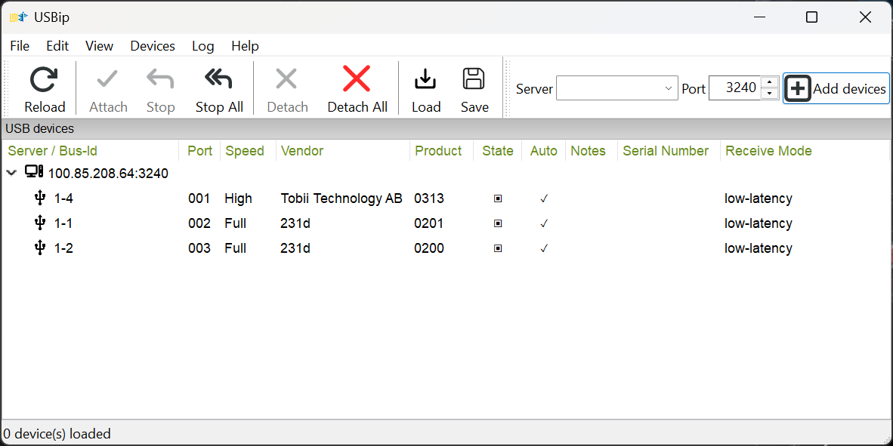

# Longcable

**A very long USB cable for your Mac.** Longcable is a native macOS
[USB/IP](https://docs.kernel.org/usb/usbip_protocol.html) server: plug a USB device into
your Mac and use it on a Windows (or Linux) PC over the network, as if it were plugged
in there. In other words: USB passthrough (USB over IP, USB redirection) from a Mac to
a PC, for joysticks, HOTAS setups, eye trackers, controllers and USB microphones.

USB/IP is built into Linux for sharing and using devices. Windows has
[usbipd-win](https://github.com/dorssel/usbipd-win) for sharing and
[usbip-win2](https://github.com/vadimgrn/usbip-win2) for using them. The Mac was the
gap: no free, working USB/IP server. Longcable fills exactly that gap.

It uses Apple's own IOUSBHost device capture: no kernel extension, no DriverKit
entitlement and no SIP changes. On Windows you use the official, signed
[usbip-win2](https://github.com/vadimgrn/usbip-win2) client, so there's nothing extra
to install there.

<p align="center">
  
</p>

## Why I built it: HOTAS and eye tracking over game streaming

I play **Star Citizen** on a Windows gaming PC and stream it to my Mac with
**Moonlight** (from a **Sunshine** or **Apollo** host; **Artemis** works the same way).
Game streaming forwards keyboard, mouse and gamepads, but not a HOTAS setup or an eye
tracker. Longcable forwards those devices to the gaming PC, so the game sees them as
locally connected.

My setup, all running through Longcable:

| Device | VID:PID | Used for |
|---|---|---|
| VKBsim Gladiator EVO **L** | `231d:0201` | left stick (dual-stick setup) |
| VKBsim Gladiator EVO **R** | `231d:0200` | right stick |
| Tobii Eye Tracker 5 | `2104:0313` | head tracking |
| Steam Controller puck | `28de:1304` | controller receiver |
| Elgato Wave:3 | `0fd9:0070` | microphone (experimental isochronous support) |

## What has been tested

On an Apple Silicon Mac (macOS 27) with a Windows 11 PC running usbip-win2 0.9.8.1:

| Test | Result |
|---|---|
| Both VKB sticks and the eye tracker at the same time | all recognised by Windows as game controllers, no transfer errors on the sticks |
| Input check over 20 seconds | ~1,240 reads per stick, zero failures |
| Unplug and replug a stick on the Mac | device left and came back on Windows by itself |
| Moving a stick to another Mac USB port | same bus ID and the same device identity on Windows |
| Killing the Longcable service | launchd restarted it; Windows reattached the devices |
| Restarting the service | Windows reattached by itself after ~30 s |
| 30-second network drop (Tailscale off) | the connection survived; nothing to reattach |
| Rebooting Windows | stashed devices came back by themselves |
| Both usbip-win2 receive modes | work; low-latency is the one I use |
| A Star Citizen session | several hours of normal gaming with both sticks and the eye tracker |
| Elgato Wave:3 microphone (experimental) | records on Windows and in Discord, no dropouts; 5× start/stop clean; after unplug/replug it needs **Reconnect** |

Automated checks run on every commit (see [the CI workflow](.github/workflows/build.yml)):
99 unit tests (USB/IP framing, transfers, sessions, device identity, the Apple-device
filter, peer allowlists) and 16 installer checks in a sandbox without sudo.

## How it works

```
USB device ──▶ Mac (Longcable) ══ USB/IP over TCP 3240 ══▶ Windows (usbip-win2) ──▶ game
```

Longcable takes the whole device away from macOS while it is shared and gives it back
when you stop sharing. Bus IDs (`1-1`, `1-2`, …) stay stable across reconnects and Mac
port changes, so the Windows side can remember them.

## Setup

### Quick start

Requires macOS 13 or later (Apple Silicon or Intel). On the Mac:

```sh
curl -fsSL https://github.com/Sapd/longcable/releases/latest/download/install.sh | bash
```

The installer verifies the release checksum, installs the background service and
opens Longcable. It allows your tailnet if Tailscale is running, otherwise your
primary LAN subnet. It prints the choice and how to override it.

1. Tick the devices you want to share in the app.
2. Click **Connect a PC**, choose Tailscale or LAN, and copy the Windows command.
3. Paste it into an **administrator PowerShell** on the PC. It installs usbip-win2
   with winget if needed, attaches shared devices and remembers them.
4. If a connection is refused, click **Allow** on the Mac, then retry the command.

### Windows

**No extra client needed.** usbip-win2 is reliable, signed and already remembers your devices across reboots and dropped connections - there's no wrapper app, no background service and nothing else running on your gaming PC.

Prefer a GUI? Open usbip-win2's own **USBip** app (`wusbip.exe`, in
`C:\Program Files\USBip`). Enter the Mac address under **Server** → **Add devices** →
select the devices → **Attach**. Tick **Auto** → **Save** to remember them.



<details>
<summary>Manual setup</summary>

### 1. Mac

Requires macOS 13 or later (Apple Silicon or Intel). Download the prebuilt release:

```sh
curl -LO https://github.com/Sapd/longcable/releases/latest/download/longcable-macos.tar.gz
tar xzf longcable-macos.tar.gz && cd longcable
bin/longcable-server list                # shows external devices, captures nothing
```

<details>
<summary>Or build from source (Xcode command-line tools, Swift 5.9+)</summary>

```sh
git clone https://github.com/Sapd/longcable.git && cd longcable
swift build -c release
```

Then use `swift run Longcable` instead of `open Longcable.app` below, or run
`scripts/package-release.sh` to build the same package as a release.
</details>

Install the background service. Arguments: the address to listen on, then which PCs may
connect.

```sh
# Tailscale (recommended): Mac's Tailscale IP, Windows PC's Tailscale IP
sudo scripts/install-mac.sh --skip-build 100.85.208.64 100.86.73.38

# LAN only: listen everywhere, allow two PCs on the home network
sudo scripts/install-mac.sh --skip-build 0.0.0.0 192.168.1.20,192.168.1.21
```

Then pick the devices to share in the menu-bar app:

```sh
open Longcable.app        # or drag it into /Applications first
```

### 2. Windows

Install [usbip-win2](https://github.com/vadimgrn/usbip-win2/releases) (signed drivers,
command line and a GUI). Then, in an administrator PowerShell:

```powershell
$usbip = 'C:\Program Files\USBip\usbip.exe'
& $usbip list -r 100.85.208.64                                       # what the Mac offers
& $usbip attach -r 100.85.208.64 -b 1-1 --receive-mode=low-latency   # attach a device
& $usbip port --stash                                                # remember it
```

**That's it: Windows remembers the connection.** Stashed devices are reattached at
every boot, and after a dropped connection usbip-win2 keeps retrying by itself. Prefer
clicking? The bundled **USBip** app (`wusbip.exe`) does the same, including an "Auto"
checkbox per device and a tray icon.

By default usbip-win2 gives up after about two hours of failed retries. To make it retry
practically forever and reconnect faster, set these values (then reboot):

```powershell
$p = 'HKLM:\SYSTEM\CurrentControlSet\Services\usbip2_ude\Parameters'
Set-ItemProperty $p ReattachMaxAttempts 1000 -Type DWord
Set-ItemProperty $p ReattachFirstDelay 5 -Type DWord
```

</details>

## Network: Tailscale or LAN

USB/IP has **no authentication and no encryption**. Anyone who can reach port 3240 and
is allowed by the peer list can take your shared devices.

- **[Tailscale](https://tailscale.com) (recommended).** One address that works at home and
  away. On the same network Tailscale connects directly over the LAN, so there's no
  extra latency. You can also use the Mac's MagicDNS name instead of the IP.
- **Plain LAN.** Works fine on a trusted home network: listen on `0.0.0.0` and list the
  PCs' LAN addresses.
- **Over the internet without a VPN: don't.** Never forward port 3240 on your router. Use
  Tailscale or WireGuard instead.

The peer argument takes IPv4 addresses or CIDR ranges (`192.168.1.0/24`,
`100.64.0.0/10`), a comma-separated mix, or `any` (prints a loud warning).
With no arguments the installer listens on `0.0.0.0` and allows the tailnet when
Tailscale is available, otherwise the primary LAN subnet. Use explicit arguments
in Manual setup to restrict this further. Refused PCs appear in the app with an
**Allow** button; click it only for a PC you recognise. These extra peers are saved
in `peers.json` and merged with the configured peers across restarts.

## FAQ

### Can I use a Tobii eye tracker with Moonlight, Sunshine or Apollo?

Yes. Game streaming forwards keyboard, mouse and gamepads, but not an eye tracker. Plug
the Tobii into the Mac you stream to, share it in Longcable and attach it on the gaming
PC: the Tobii software and games such as Star Citizen see it as locally connected. Tested
with a Tobii Eye Tracker 5.

### Moonlight USB passthrough: how do I use a HOTAS or joystick while streaming?

The same way. Moonlight has no general USB passthrough, so HOTAS sticks, throttles and
pedals stay on the Mac. Longcable forwards them over USB/IP to the PC running Sunshine or
Apollo. Tested with two VKB Gladiator EVO sticks in a dual-stick setup.

### How do I use a USB device from my Mac on a Windows PC?

Install Longcable on the Mac, tick the device in the app, click **Windows command** on
the device and paste the command into an administrator PowerShell on the PC. Windows
remembers it and reconnects it after reboots. See [Quick start](#quick-start).

### Is there a free VirtualHere alternative for macOS?

Longcable is free and open source (GPL-3.0) and uses the standard USB/IP protocol, so
it works with the free, signed usbip-win2 client on Windows and the built-in usbip on
Linux. See [Alternatives](#alternatives) for the differences.

### Does it work over the internet?

Yes, through [Tailscale](https://tailscale.com) or another VPN such as WireGuard. Don't
forward the USB/IP port on your router: USB/IP has no authentication or encryption.

### Can I share a USB microphone?

Experimentally. An Elgato Wave:3 works on Windows, including in Discord; see
[Limitations](#limitations) for the known issue after unplugging it.

## Alternatives

### Longcable as a VirtualHere alternative for Mac

[VirtualHere](https://www.virtualhere.com) is the established commercial way to share
USB devices from a Mac over the network. Longcable is a free, open-source alternative
for the same job:

| | Longcable | VirtualHere |
|---|---|---|
| Price | free | free for one device, paid license for more |
| Source | open source (GPL-3.0) | closed source |
| Protocol | standard USB/IP | its own protocol |
| Client on Windows | usbip-win2 (free, signed drivers) | VirtualHere client |
| Client on Linux | built-in `usbip` | VirtualHere client |
| Mac server (share devices *from* a Mac) | native, IOUSBHost, no kernel extension | yes |
| Mac client (use remote devices *on* a Mac) | **not supported** | yes |
| USB audio and webcams | audio experimental, webcams untested | supported |

VirtualHere is more mature, especially for audio and video devices. Longcable is a good
fit if you want free, open source and standard USB/IP, for example for HOTAS sticks,
eye trackers and controllers.

### Others
- **[usbipd-win](https://github.com/dorssel/usbipd-win):** the same idea in the other
  direction, sharing devices *from* a Windows PC.

## Reference

- Settings: `/Library/Application Support/Longcable/`. Logs: `/Library/Logs/Longcable/`.
  Service: launchd `org.sapd.longcable`.
- Local control: `longcable-server --control status|share|unshare|reconnect [BUSID]`
  or `longcable-server --control allow-peer|forget-peer IPV4_OR_CIDR`
  (changes require root or the signed-in console user). Forget removes saved additions;
  it does not remove peers supplied in the launchd arguments.
- Fixed devices can be given as extra `VID PID LOCATION LABEL` groups, e.g.
  `231d 0201 02131200 VKBLEFT0201`. Their order fixes the bus IDs. Devices without a
  hardware serial number get the label as a stable software serial. Identical models
  without serials use LOCATION to stay bound to their USB ports.
- Apple's built-in devices (vendor `05ac`) are hidden, so you can't accidentally share
  your MacBook's keyboard or trackpad.
- Preview the install without sudo: `scripts/install-mac.sh --dry-run 0.0.0.0 192.168.1.20`.
- Uninstall: `sudo scripts/uninstall-mac.sh`.
- Development: `swift build`, `swift test`, `scripts/test-install.sh`.
- Releases: pushing a `v*` tag builds universal binaries in GitHub Actions and attaches
  `longcable-macos.tar.gz` (with a SHA-256 file) to a GitHub release. The binaries are
  not notarized; downloading with `curl` as shown above avoids the Gatekeeper prompt.

## Limitations

- **Mac as client is not supported.** Longcable only shares devices *from* a Mac. Using
  a remote USB device *on* a Mac would need a virtual USB host controller, which macOS
  doesn't offer to third-party software without a kernel or DriverKit extension.
- **Isochronous transfers (USB audio) are EXPERIMENTAL.** Tested with an Elgato Wave:3
  microphone on Windows: recording works, including in Discord, with no dropouts on
  Tailscale, and repeated start/stop works. Webcams are untested.
  - **Known issue:** after the microphone is unplugged and replugged, or the Longcable
    service restarts, Windows reattaches it but records silence. **Workaround:** click
    **Reconnect** on the device in the Longcable app (or run
    `longcable-server --control reconnect 1-5` with its bus ID). It then works again.
  - USB/IP over TCP is sensitive to jitter: audio is realistic on a LAN or a direct
    Tailscale connection; webcams also need substantial bandwidth.
  - Full- and high-speed USB only; USB 3 isochronous devices are rejected.
- **Apps holding a device:** if another app (for example Wave Link for Elgato mics) has
  the device open, the Longcable app names it ("In use by …") and sharing waits until
  you close that app. Windows then attaches it by itself if the device is stashed.
- **Identical devices without a serial number** are bound to their USB ports. Keep
  them in the same ports so each keeps its own identity and bus ID.
- **Up to 16 devices**, 1 MiB per transfer.
- **Shared devices disappear from the Mac** while a client is attached. That's how
  device capture works.
- **Root required.** The server runs as a launchd system service.
- **No security of its own.** USB/IP has no authentication or encryption; see
  [Network](#network-tailscale-or-lan).
- **Not notarized.** Downloading through a browser triggers Gatekeeper; use `curl` as
  shown above.
- **Less tested:** Mac sleep/wake, very long sessions and Linux clients. Tested hardware
  is listed above; other devices may well work but haven't been tried.

## AI transparency

> I use AI to build my projects, a mix of Claude and Codex, with a lot of verification
> loops: multiple review rounds (for example BMAD reviews), tests written alongside the
> code and validation on real hardware. AI speeds up the writing; the design decisions,
> testing and responsibility are mine.
>
> I've been an open-source developer for years: see [my GitHub profile](https://github.com/Sapd)
> and projects like [HeadsetControl](https://github.com/Sapd/HeadsetControl) or the OpenID
> Connect login in [Audiobookshelf](https://github.com/advplyr/audiobookshelf), which I
> took over from [its first implementation](https://github.com/advplyr/audiobookshelf/pull/1636)
> and have continued since ([my PRs](https://github.com/advplyr/audiobookshelf/pulls?q=is%3Apr+author%3ASapd)).

<details>
<summary>Linux and other platforms</summary>

| Platform | Sharing devices | Using devices |
|---|---|---|
| macOS | Longcable | Third-party client required |
| Linux | Built-in `usbip-host` + `usbipd` | Built-in `vhci-hcd` + `usbip` |
| Windows | [usbipd-win](https://github.com/dorssel/usbipd-win) | [usbip-win2](https://github.com/vadimgrn/usbip-win2) |

**Linux client:** install your distribution's `usbip` tools, then:

```sh
sudo modprobe vhci-hcd
usbip list -r MAC_IP
sudo usbip attach -r MAC_IP -b 1-1
```

Linux has no built-in stash. Use a script or systemd unit to attach at boot, for
example `/etc/systemd/system/longcable.service` (replace `MAC_IP` and `1-1`):

```ini
[Unit]
Description=Attach Longcable USB device
Wants=network-online.target
After=network-online.target

[Service]
Type=oneshot
ExecStartPre=/sbin/modprobe vhci-hcd
ExecStart=/usr/sbin/usbip attach -r MAC_IP -b 1-1
RemainAfterExit=yes
Restart=on-failure
RestartSec=10

[Install]
WantedBy=multi-user.target
```

Check your distribution's executable paths, then enable with
`sudo systemctl enable --now longcable`. This retries failed boot attachments;
a separate reconnect script is needed to detect a connection lost later. Linux
clients are still less tested.

**Linux server:** Longcable is not needed. Load `usbip-host`, run `sudo usbipd -D`,
find the device with `usbip list -l`, and share it with
`sudo usbip bind -b BUSID`. Use the same trusted-network precautions as above.

**Windows server:** use usbipd-win; `usbipd list` shows devices and
`usbipd bind --busid BUSID` shares one from an administrator terminal. Longcable
is the server for the opposite direction, from a Mac.

</details>

## License

GPL-3.0-or-later. Copyright 2026 Denis Arnst ([Sapd](https://github.com/Sapd)).
