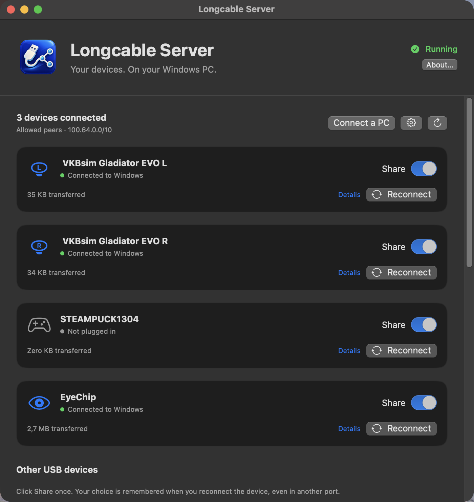

# Longcable

**A very long USB cable for your Mac.** Longcable is a native macOS
[USB/IP](https://docs.kernel.org/usb/usbip_protocol.html) server: plug a USB device into
your Mac and use it on a Windows (or Linux) PC over the network, as if it were plugged
in there.

It uses Apple's own IOUSBHost device capture: no kernel extension, no DriverKit
entitlement and no SIP changes. On Windows you use the official, signed
[usbip-win2](https://github.com/vadimgrn/usbip-win2) client, so there's nothing extra
to install there.

<p align="center">
  
</p>

## Why I built it

I play **Star Citizen** on a Windows gaming PC and stream it to my Mac with
**Moonlight** (from a **Sunshine** or **Apollo** host; **Artemis** works the same way).
Game streaming forwards keyboard, mouse and gamepads, but not a HOTAS setup or an eye
tracker. Longcable forwards those devices to the gaming PC, so the game sees them as
locally connected.

My setup, all running through Longcable:

| Device | VID:PID | Used for |
|---|---|---|
| VKBsim Gladiator EVO **L** | `231d:0201` | left stick (dual-stick setup) |
| VKBsim Gladiator EVO **R** | `231d:0200` | right stick |
| Tobii Eye Tracker 5 | `2104:0313` | head tracking |
| Steam Controller puck | `28de:1304` | controller receiver |

## What has been tested

On an Apple Silicon Mac (macOS 27) with a Windows 11 PC running usbip-win2 0.9.8.1:

| Test | Result |
|---|---|
| Both VKB sticks and the eye tracker at the same time | all recognised by Windows as game controllers, no transfer errors on the sticks |
| Input check over 20 seconds | ~1,240 reads per stick, zero failures |
| Unplug and replug a stick on the Mac | device left and came back on Windows by itself |
| Moving a stick to another Mac USB port | same bus ID and the same device identity on Windows |
| Killing the Longcable service | launchd restarted it; Windows reattached the devices |
| Restarting the service | Windows reattached by itself after ~30 s |
| 30-second network drop (Tailscale off) | the connection survived; nothing to reattach |
| Rebooting Windows | stashed devices came back by themselves |
| Both usbip-win2 receive modes | work; low-latency is used day to day |
| Normal Star Citizen sessions | hours of gaming with both sticks and the eye tracker |

Beyond these specific checks, it is in daily use: I play Star Citizen with it for hours
at a time.

Automated checks run on every commit (see [the CI workflow](.github/workflows/build.yml)):
62 unit tests (USB/IP framing, transfers, sessions, device identity, the Apple-device
filter, peer allowlists) and 8 installer checks in a sandbox without sudo.

## How it works

```
USB device ──▶ Mac (Longcable) ══ USB/IP over TCP 3240 ══▶ Windows (usbip-win2) ──▶ game
```

Longcable takes the whole device away from macOS while it is shared and gives it back
when you stop sharing. Bus IDs (`1-1`, `1-2`, …) stay stable across reconnects and Mac
port changes, so the Windows side can remember them.

## Setup

### 1. Mac

Requires macOS 13 or later (Apple Silicon or Intel). Download the prebuilt release:

```sh
curl -LO https://github.com/Sapd/longcable/releases/latest/download/longcable-macos.tar.gz
tar xzf longcable-macos.tar.gz && cd longcable
bin/longcable-server list                # shows external devices, captures nothing
```

<details>
<summary>Or build from source (Xcode command-line tools, Swift 5.9+)</summary>

```sh
git clone https://github.com/Sapd/longcable.git && cd longcable
swift build -c release
```

Then use `swift run Longcable` instead of `open Longcable.app` below, or run
`scripts/package-release.sh` to build the same package as a release.
</details>

Install the background service. Arguments: the address to listen on, then which PCs may
connect.

```sh
# Tailscale (recommended): Mac's Tailscale IP, Windows PC's Tailscale IP
sudo scripts/install-mac.sh --skip-build 100.85.208.64 100.86.73.38

# LAN only: listen everywhere, allow two PCs on the home network
sudo scripts/install-mac.sh --skip-build 0.0.0.0 192.168.1.20,192.168.1.21
```

Then pick the devices to share in the menu-bar app:

```sh
open Longcable.app        # or drag it into /Applications first
```

### 2. Windows

Install [usbip-win2](https://github.com/vadimgrn/usbip-win2/releases) (signed drivers,
command line and a GUI). Then, in an administrator PowerShell:

```powershell
$usbip = 'C:\Program Files\USBip\usbip.exe'
& $usbip list -r 100.85.208.64                                       # what the Mac offers
& $usbip attach -r 100.85.208.64 -b 1-1 --receive-mode=low-latency   # attach a device
& $usbip port --stash                                                # remember it
```

**That's it: Windows remembers the connection.** Stashed devices are reattached at
every boot, and after a dropped connection usbip-win2 keeps retrying by itself. Prefer
clicking? The bundled **USBip** app (`wusbip.exe`) does the same, including an "Auto"
checkbox per device and a tray icon.

By default usbip-win2 gives up after about two hours of failed retries. To make it retry
practically forever and reconnect faster, set these values (then reboot):

```powershell
$p = 'HKLM:\SYSTEM\CurrentControlSet\Services\usbip2_ude\Parameters'
Set-ItemProperty $p ReattachMaxAttempts 1000 -Type DWord
Set-ItemProperty $p ReattachFirstDelay 5 -Type DWord
```

**Linux:** `sudo modprobe vhci-hcd`, then `usbip list -r MAC_IP` and
`sudo usbip attach -r MAC_IP -b 1-1`.

## Network: Tailscale or LAN

USB/IP has **no authentication and no encryption**. Anyone who can reach port 3240 and
is allowed by the peer list can take your shared devices.

- **[Tailscale](https://tailscale.com) (recommended).** One address that works at home and
  away. On the same network Tailscale connects directly over the LAN, so there's no
  extra latency. You can also use the Mac's MagicDNS name instead of the IP.
- **Plain LAN.** Works fine on a trusted home network: listen on `0.0.0.0` and list the
  PCs' LAN addresses.
- **Over the internet without a VPN: don't.** Never forward port 3240 on your router. Use
  Tailscale or WireGuard instead.

The peer argument takes one IPv4, a comma-separated list, or `any` (prints a loud
warning).

## Alternatives

- **[VirtualHere](https://www.virtualhere.com):** the established commercial option, with
  its own server and client for macOS, Windows and Linux. It is closed source and
  needs a paid license to share more than one device. Longcable is a free, open-source
  alternative that speaks standard USB/IP, so it works with the signed usbip-win2 client
  and Linux's built-in `usbip`.
- **[usbipd-win](https://github.com/dorssel/usbipd-win):** the same idea in the other
  direction, sharing devices *from* a Windows PC.

## Reference

- Settings: `/Library/Application Support/Longcable/`. Logs: `/Library/Logs/Longcable/`.
  Service: launchd `org.sapd.longcable`.
- Local control: `longcable-server --control status|share|unshare|reconnect [BUSID]`
  (root or the signed-in console user).
- Fixed devices can be given as extra `VID PID LOCATION LABEL` groups, e.g.
  `231d 0201 02131200 VKBLEFT0201`. Their order fixes the bus IDs. Devices without a
  hardware serial number get the label as a stable software serial. Identical models
  without serials use LOCATION to stay bound to their USB ports.
- Apple's built-in devices (vendor `05ac`) are hidden, so you can't accidentally share
  your MacBook's keyboard or trackpad.
- Preview the install without sudo: `scripts/install-mac.sh --dry-run 0.0.0.0 192.168.1.20`.
- Uninstall: `sudo scripts/uninstall-mac.sh`.
- Development: `swift build`, `swift test`, `scripts/test-install.sh`.
- Releases: pushing a `v*` tag builds universal binaries in GitHub Actions and attaches
  `longcable-macos.tar.gz` (with a SHA-256 file) to a GitHub release. The binaries are
  not notarized; downloading with `curl` as shown above avoids the Gatekeeper prompt.

## Limitations

- **No isochronous transfers.** Webcams, microphones, USB audio interfaces and headsets
  won't work. Input devices like joysticks, eye trackers, controllers and keyboards
  are fine.
- **Alternate setting 0 only.** Devices that switch interface modes may fail.
- **Identical devices without a serial number** are bound to their USB ports. Keep
  them in the same ports so each keeps its own identity and bus ID.
- **Up to 16 devices**, 1 MiB per transfer.
- **Shared devices disappear from the Mac** while a client is attached. That's how
  device capture works.
- **Root required.** The server runs as a launchd system service.
- **No security of its own.** USB/IP has no authentication or encryption; see
  [Network](#network-tailscale-or-lan).
- **Not notarized.** Downloading through a browser triggers Gatekeeper; use `curl` as
  shown above.
- **Less tested:** Mac sleep/wake, very long sessions and Linux clients. Tested hardware
  is listed above; other devices may well work but haven't been tried.

## AI transparency

> I use AI to build my projects, a mix of Claude and Codex, with a lot of verification
> loops: multiple review rounds (for example BMAD reviews), tests written alongside the
> code and validation on real hardware. AI speeds up the writing; the design decisions,
> testing and responsibility are mine.
>
> I've been an open-source developer for years: see [my GitHub profile](https://github.com/Sapd)
> and projects like [HeadsetControl](https://github.com/Sapd/HeadsetControl) or the OpenID
> Connect login in [Audiobookshelf](https://github.com/advplyr/audiobookshelf), which I
> took over from [its first implementation](https://github.com/advplyr/audiobookshelf/pull/1636)
> and have continued since ([my PRs](https://github.com/advplyr/audiobookshelf/pulls?q=is%3Apr+author%3ASapd)).

## License

GPL-3.0-or-later. Copyright 2026 Denis Arnst ([Sapd](https://github.com/Sapd)).
