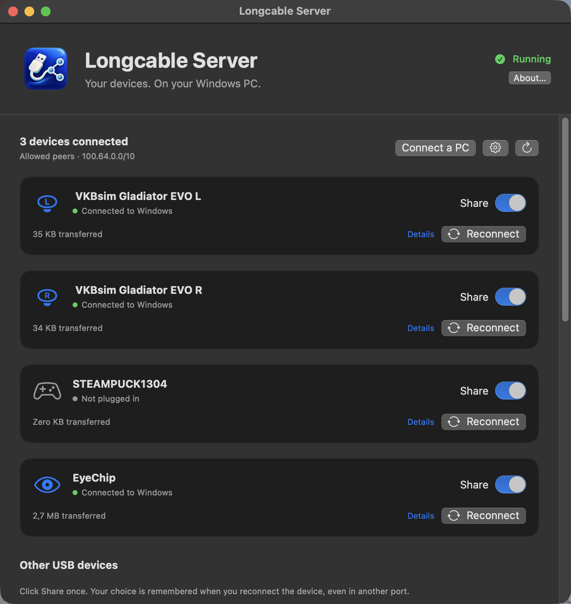
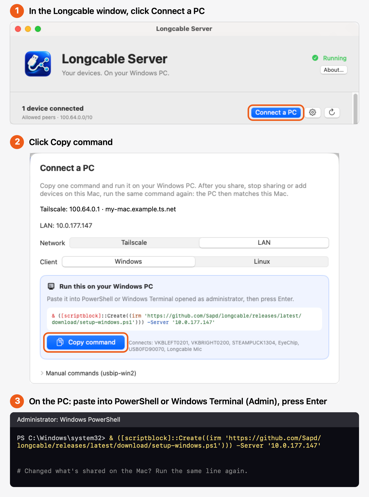
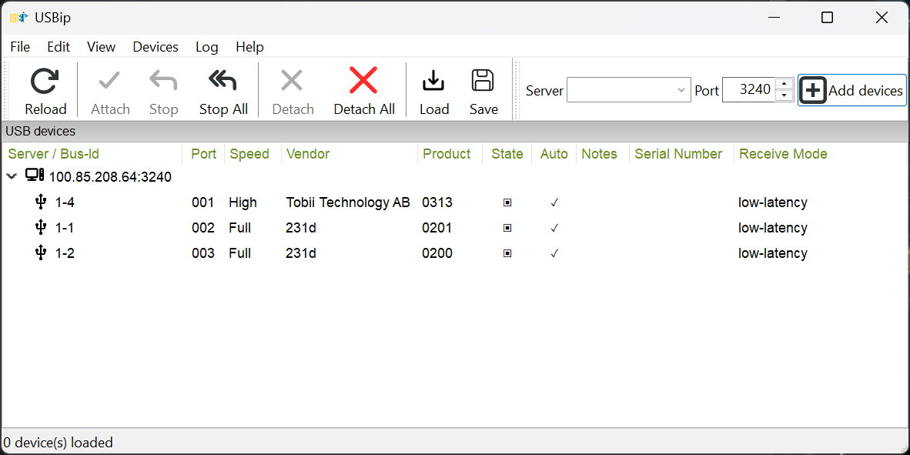
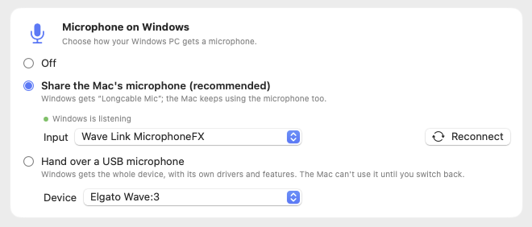

# Longcable: USB/IP server for macOS

**A very long USB cable for your Mac.** Longcable is a free, open-source, native macOS
[USB/IP](https://docs.kernel.org/usb/usbip_protocol.html) server (USB over IP): plug a
USB device into your Mac and use it on a Windows (or Linux) PC over the network, as if
it were plugged in there. In other words: USB passthrough (USB redirection) from a Mac
to a PC, for joysticks, HOTAS setups, eye trackers, controllers and USB microphones.

**It also forwards your Mac's microphone to a Windows PC** (experimental). Any Mac input (the built-in
MacBook microphone, a USB mic, AirPods) shows up on Windows as a microphone called
"Longcable Mic", while the Mac keeps using it. See
[Forward your Mac's microphone to Windows](#forward-your-macs-microphone-to-windows-longcable-mic).

It is made for people who stream games from a Windows gaming PC to a Mac with Moonlight,
Sunshine, Apollo or Artemis and need their USB devices, and their voice, on the gaming
PC: with the forwarded Mac microphone you can talk in Discord or in a game.

**[Quick start](#quick-start)** · [Windows setup](#windows) · [Forward your microphone](#forward-your-macs-microphone-to-windows-longcable-mic) · [FAQ](#faq) · [VirtualHere alternative](#longcable-as-a-virtualhere-alternative-for-mac)

Linux and Windows have USB/IP servers; the Mac had no free, working one. Longcable uses
Apple's own IOUSBHost device capture (no kernel extension, no DriverKit entitlement, no
SIP changes), and Windows uses the official, signed
[usbip-win2](https://github.com/vadimgrn/usbip-win2) client.

<p align="center">
  
</p>

## Setup: install on the Mac, connect a Windows PC

### Quick start

Requires macOS 13 or later (Apple Silicon or Intel). On the Mac:

```sh
curl -fsSL https://github.com/Sapd/longcable/releases/latest/download/install.sh | bash
```

The installer verifies the release checksum, installs the background service and
opens Longcable. It allows your tailnet if Tailscale is running, otherwise your
primary LAN subnet. It prints the choice and how to override it.

Or with [Homebrew](https://github.com/Sapd/homebrew-longcable), which also keeps it
updated with `brew upgrade`:

```sh
brew install --cask sapd/longcable/longcable
```

1. Tick the devices you want to share in the app (and, under **Microphone on Windows**,
   choose **Share the Mac's microphone** if you want it).
2. Click **Connect a PC**, then **Copy command**.
3. Paste it into **PowerShell or Windows Terminal opened as administrator** on the PC and
   press Enter. It installs usbip-win2 with winget if needed, attaches the shared devices
   and remembers them.
4. If a connection is refused, click **Allow** on the Mac, then run the command again.

Changed what's shared later? Run **the same command** again: the script asks the Mac what
it shares, so the PC then matches the Mac (new devices are attached, removed ones are
detached, unplugged ones are kept for later).

### Windows

Nothing extra runs on the gaming PC: usbip-win2 is signed and remembers your devices
across reboots and dropped connections. The command runs
[`setup-windows.ps1`](scripts/setup-windows.ps1): it asks the Mac what it shares, attaches
and detaches with usbip-win2 and saves the list, without touching other servers' devices.

**Keep this PC in step automatically** (in Connect a PC, opt-in) adds a Windows scheduled
task that runs the same script every minute and at startup, as the system account from
`C:\Program Files\Longcable` (admin-only, with a `sync.log`). It skips runs when a
different Mac answers at the address. Like USB/IP itself it trusts the network, so use it
over Tailscale or a network you trust. To stop it, run the command with `-RemoveAutoSync`.

<p align="center">
  
</p>

<details>
<summary>Prefer a GUI? usbip-win2's own USBip app</summary>

Open usbip-win2's **USBip** app (`wusbip.exe`, in `C:\Program Files\USBip`). Enter the
Mac address under **Server** → **Add devices** → select the devices → **Attach**. Tick
**Auto** → **Save** to remember them.



</details>

<details>
<summary>Manual setup</summary>

### 1. Mac

Requires macOS 13 or later (Apple Silicon or Intel). Download the prebuilt release:

```sh
curl -LO https://github.com/Sapd/longcable/releases/latest/download/longcable-macos.tar.gz
tar xzf longcable-macos.tar.gz && cd longcable
bin/longcable-server list                # shows external devices, captures nothing
```

<details>
<summary>Or build from source (Xcode command-line tools, Swift 5.9+)</summary>

```sh
git clone https://github.com/Sapd/longcable.git && cd longcable
swift build -c release
```

Then use `swift run Longcable` instead of `open Longcable.app` below, or run
`scripts/package-release.sh` to build the same package as a release.
</details>

Install the background service. Arguments: the address to listen on, then which PCs may
connect.

```sh
# Tailscale (recommended): Mac's Tailscale IP, Windows PC's Tailscale IP
sudo scripts/install-mac.sh --skip-build 100.64.0.1 100.64.0.2

# LAN only: listen everywhere, allow two PCs on the home network
sudo scripts/install-mac.sh --skip-build 0.0.0.0 192.168.1.20,192.168.1.21
```

Then pick the devices to share in the menu-bar app:

```sh
open Longcable.app        # or drag it into /Applications first
```

### 2. Windows

Install [usbip-win2](https://github.com/vadimgrn/usbip-win2/releases) (signed drivers,
command line and a GUI). Then, in an administrator PowerShell:

```powershell
$usbip = 'C:\Program Files\USBip\usbip.exe'
& $usbip list -r 100.64.0.1                                       # what the Mac offers
& $usbip attach -r 100.64.0.1 -b 1-1 --receive-mode=low-latency   # attach a device
& $usbip port --stash                                                # remember it
```

Stashed devices are reattached at every boot, and usbip-win2 retries dropped connections
by itself. By default it gives up after about two hours; to retry practically forever and
reconnect faster, set these values (then reboot):

```powershell
$p = 'HKLM:\SYSTEM\CurrentControlSet\Services\usbip2_ude\Parameters'
Set-ItemProperty $p ReattachMaxAttempts 1000 -Type DWord
Set-ItemProperty $p ReattachFirstDelay 5 -Type DWord
```

</details>

## Features

- **USB over IP from a Mac** to Windows or Linux, over the standard USB/IP protocol (TCP 3240).
- **Nothing extra on Windows:** the signed usbip-win2 client, one setup command, optional automatic syncing.
- **Stable bus IDs** across reconnects and Mac port changes.
- **Menu-bar app** in English and German; install with a script or Homebrew.
- **Tailscale or LAN:** only PCs on the peer list may connect.
- **Mac microphone on Windows** ([Longcable Mic](#forward-your-macs-microphone-to-windows-longcable-mic), experimental), while the Mac keeps using it; or hand a USB microphone over whole.
- **Free and open source** (GPL-3.0).

## Why I built it: HOTAS and eye tracking over game streaming

I play **Star Citizen** on a Windows gaming PC and stream it to my Mac with
**Moonlight** (from a **Sunshine** or **Apollo** host; **Artemis** works the same way).
Game streaming forwards keyboard, mouse and gamepads, but not a HOTAS setup or an eye
tracker. Longcable forwards those devices to the gaming PC, so the game sees them as
locally connected.

My setup, all running through Longcable:

| Device | VID:PID | Used for |
|---|---|---|
| VKBsim Gladiator EVO **L** | `231d:0201` | left stick (dual-stick setup) |
| VKBsim Gladiator EVO **R** | `231d:0200` | right stick |
| Tobii Eye Tracker 5 | `2104:0313` | head tracking |
| Steam Controller puck | `28de:1304` | controller receiver |
| Elgato Wave:3 | `0fd9:0070` | microphone (experimental isochronous support) |

## Tested hardware and results

Tested on an Apple Silicon Mac (macOS 27) with Windows 11 and usbip-win2 0.9.8.1: two VKB
sticks and a Tobii eye tracker at once for hours of Star Citizen; devices come back by
themselves after unplugging, port changes, service restarts, network drops and Windows
reboots; Longcable Mic works in Discord while the Mac keeps the microphone.

<details>
<summary>All test results</summary>

| Test | Result |
|---|---|
| Both VKB sticks and the eye tracker at the same time | all recognised by Windows as game controllers, no transfer errors on the sticks |
| Input check over 20 seconds | ~1,240 reads per stick, zero failures |
| Unplug and replug a stick on the Mac | device left and came back on Windows by itself |
| Moving a stick to another Mac USB port | same bus ID and the same device identity on Windows |
| Killing the Longcable service | launchd restarted it; Windows reattached the devices |
| Restarting the service | Windows reattached by itself after ~30 s |
| 30-second network drop (Tailscale off) | the connection survived; nothing to reattach |
| Rebooting Windows | stashed devices came back by themselves |
| Both usbip-win2 receive modes | work; low-latency is the one I use |
| A Star Citizen session | several hours of normal gaming with both sticks and the eye tracker |
| Elgato Wave:3 microphone (experimental) | records on Windows and in Discord, no dropouts; 5× start/stop clean; after unplug/replug it needs **Reconnect** |
| Longcable Mic (virtual microphone, experimental) | Windows loads its own USB audio driver, no errors in Device Manager; a 440 Hz test tone arrives at exactly 440 Hz with no gaps; the MacBook microphone records on Windows while the Mac records it at the same time; Discord's mic test plays the voice back |

Automated checks run on every commit (see [the CI workflow](.github/workflows/build.yml)):
Unit tests (USB/IP framing, transfers, sessions, device identity, the Apple-device
filter, peer allowlists, the virtual microphone) and installer checks in a sandbox without sudo.

The Windows setup command has its own end-to-end test against a real PC
([`scripts/test-setup-e2e.sh`](scripts/test-setup-e2e.sh)): first setup, re-runs,
unplugged devices, the same Mac under another name, an unreachable Mac, an older Longcable
service, a cut-off reply, automatic syncing (install, a change followed by the task,
removal) and removal of everything, with other servers' devices left untouched.

</details>

## How it works: USB/IP from a Mac to Windows

```
USB device ──▶ Mac (Longcable) ══ USB/IP over TCP 3240 ══▶ Windows (usbip-win2) ──▶ game
```

Longcable takes the whole device away from macOS while it is shared and gives it back
when you stop sharing. Bus IDs (`1-1`, `1-2`, …) stay stable across reconnects and Mac
port changes, so the Windows side can remember them.

[Longcable Mic](#forward-your-macs-microphone-to-windows-longcable-mic) is different: a
virtual USB microphone (bus ID `2-1`) that Longcable creates itself, so the Mac keeps the
real one.

## Forward your Mac's microphone to Windows (Longcable Mic)

Sharing a USB microphone hands the whole device to Windows. **Longcable Mic** doesn't:
Longcable.app records any Mac input through Core Audio (a USB mic, the built-in MacBook
microphone, AirPods), and Windows gets a virtual USB microphone called "Longcable Mic" over
the same USB/IP connection. Mac apps keep using the microphone at the same time. Use it to
talk in Discord or in-game voice chat when your streaming setup doesn't carry your
microphone. It is **experimental**.

```
Mac microphone ──▶ Longcable.app ══ USB/IP ══▶ Windows: "Longcable Mic" ──▶ Discord / game
      └──▶ Mac apps keep using it            (records only while Windows listens)
```

### Turn on Longcable Mic

<p align="center">
  
</p>

It starts switched off, so nothing records until you turn it on:

1. In the Longcable window, under **Microphone on Windows**, choose **Share the Mac's
   microphone** and pick an input (or keep
   *System default*). The same choice is in the menu bar under **Microphone on Windows**.
   macOS asks once for microphone access.
2. Click **Connect a PC** → **Copy command** and run it on the PC, like for any other
   device (the microphone is bus `2-1`).
3. On Windows, pick **Longcable Mic** as the microphone in Discord, the game or
   *Sound settings*.

### Good to know

- The Mac records only while a Windows app actually has the microphone open; the orange
  recording dot on the Mac means Windows is listening.
- Longcable.app must be running (it lives in the menu bar). If it is closed, Windows gets
  silence instead of an error, and the sound comes back when the app starts again.
- Mono, 48 kHz, 16-bit, about 40–60 ms of delay (an estimate): made for voice chat.
- Windows uses its built-in USB Audio Class 1 driver; nothing extra to install.
- USB microphones appear in the **Microphone on Windows** card instead of the device list
  (webcams with a microphone stay in the list).
- The app is signed ad hoc, so macOS may ask for microphone access again after an update.

## Network: Tailscale or LAN

USB/IP has **no authentication and no encryption**. Anyone who can reach port 3240 and
is allowed by the peer list can take your shared devices.

- **[Tailscale](https://tailscale.com) (recommended).** One address that works at home and
  away. On the same network Tailscale connects directly over the LAN, so there's no
  extra latency. You can also use the Mac's MagicDNS name instead of the IP.
- **Plain LAN.** Works fine on a trusted home network: listen on `0.0.0.0` and list the
  PCs' LAN addresses.
- **Over the internet without a VPN: don't.** Never forward port 3240 on your router. Use
  Tailscale or WireGuard instead.

By default the installer allows the tailnet when Tailscale runs, otherwise the primary LAN
subnet; Manual setup takes IPv4 addresses or CIDR ranges to restrict this. Refused PCs
appear in the app with an **Allow** button: click it only for a PC you recognise.

## FAQ

### Can I use a Tobii eye tracker with Moonlight, Sunshine or Apollo?

Yes. Game streaming forwards keyboard, mouse and gamepads, but not an eye tracker. Plug
the Tobii into the Mac you stream to, share it in Longcable and attach it on the gaming
PC: the Tobii software and games such as Star Citizen see it as locally connected. Tested
with a Tobii Eye Tracker 5.

### Moonlight USB passthrough: how do I use a HOTAS or joystick while streaming?

The same way. Moonlight has no general USB passthrough, so HOTAS sticks, throttles and
pedals stay on the Mac. Longcable forwards them over USB/IP to the PC running Sunshine or
Apollo. Tested with two VKB Gladiator EVO sticks in a dual-stick setup.

### How do I use a USB device from my Mac on a Windows PC?

Install Longcable on the Mac, tick the device in the app, click **Windows command** on
the device and paste the command into an administrator PowerShell on the PC. Windows
remembers it and reconnects it after reboots. See [Quick start](#quick-start).

### Is there a free USB/IP server for macOS?

Yes, that is what Longcable is. It uses Apple's IOUSBHost device capture, so it needs no
kernel extension, no DriverKit entitlement and no SIP changes. It requires macOS 13 or
later (Apple Silicon or Intel).

### Is there a free VirtualHere alternative for macOS?

Longcable is free and open source (GPL-3.0) and uses the standard USB/IP protocol, so
it works with the free, signed usbip-win2 client on Windows and the built-in usbip on
Linux. See [Alternatives](#alternatives) for the differences.

### Does it work over the internet?

Yes, through [Tailscale](https://tailscale.com) or another VPN such as WireGuard. Don't
forward the USB/IP port on your router: USB/IP has no authentication or encryption.

### How do I forward my microphone from my Mac to a Windows PC?

Under **Microphone on Windows** in the app, choose **Share the Mac's microphone**, run the
Windows command and pick **Longcable Mic** on Windows. Any Mac input works (USB mic,
MacBook microphone, AirPods). See [Longcable Mic](#forward-your-macs-microphone-to-windows-longcable-mic); it is experimental.

### Can I use my Mac mic in Discord on my gaming PC?

Yes. With Longcable Mic on, Windows has a microphone called "Longcable Mic". Select it
as the input device in Discord. In my test on Windows 11, Discord's mic test played the
voice back. The sound is mono, 48 kHz, with about 40–60 ms of delay (an estimate).

### Can I still use the microphone on the Mac at the same time?

Yes. Longcable Mic records the microphone like any other Mac app, so FaceTime, Zoom or
Discord on the Mac keep working while Windows hears it too. (Handing a USB microphone over
is different: then Windows gets the whole device.)

### Moonlight microphone: how do I talk in game while streaming?

When your streaming setup doesn't carry your microphone, use
[Longcable Mic](#forward-your-macs-microphone-to-windows-longcable-mic): the gaming PC gets a virtual USB microphone fed by the Mac you
stream to. Pick it in the game's voice settings (for example Star Citizen) or in
Discord. Nothing extra is needed on Windows besides usbip-win2.

### Does Longcable record my microphone all the time?

No. Longcable Mic stays off until you flip its switch in the app. When it is on, the Mac records only while a Windows
app has the microphone open, and macOS shows its orange recording indicator then.

### Can I share a USB microphone?

Yes, in two ways, both under **Microphone on Windows** in the app. **Share the Mac's
microphone** gives Windows [Longcable Mic](#forward-your-macs-microphone-to-windows-longcable-mic)
while the Mac keeps using the microphone. **Hand over a USB microphone** gives Windows the
whole device with its own drivers: an Elgato Wave:3 works on Windows, including in Discord
(experimental); see [Limitations](#limitations) for the known issue after unplugging it.

## Alternatives

### Longcable as a VirtualHere alternative for Mac

[VirtualHere](https://www.virtualhere.com) is the established commercial way to share
USB devices from a Mac over the network. Longcable is a free, open-source alternative
for the same job:

| | Longcable | VirtualHere |
|---|---|---|
| Price | free | free for one device, paid license for more |
| Source | open source (GPL-3.0) | closed source |
| Protocol | standard USB/IP | its own protocol |
| Client on Windows | usbip-win2 (free, signed drivers) | VirtualHere client |
| Client on Linux | built-in `usbip` | VirtualHere client |
| Mac server (share devices *from* a Mac) | native, IOUSBHost, no kernel extension | yes |
| Mac client (use remote devices *on* a Mac) | **not supported** | yes |
| Mac microphone on Windows, Mac keeps using it | **yes**: [Longcable Mic](#forward-your-macs-microphone-to-windows-longcable-mic), a virtual USB microphone fed from any Mac input (built-in, USB, AirPods); experimental | no: a USB microphone can only be passed through whole, so the Mac loses it; built-in and Bluetooth microphones can't be shared |
| USB audio passthrough and webcams | audio experimental, webcams untested | supported |

VirtualHere is more mature, especially for audio and video devices. Longcable is a good
fit if you want free, open source and standard USB/IP, for example for HOTAS sticks,
eye trackers and controllers, or if you want your Mac's microphone on the PC without
handing it over.

### Others
- **[usbipd-win](https://github.com/dorssel/usbipd-win):** the same idea in the other
  direction, sharing devices *from* a Windows PC.

## Reference

<details>
<summary>Paths, local controls, fixed devices, development and releases</summary>

- Settings: `/Library/Application Support/Longcable/`. Logs: `/Library/Logs/Longcable/`.
  Service: launchd `org.sapd.longcable`.
- Local control: `longcable-server --control status|share|unshare|reconnect [BUSID]`
  or `longcable-server --control allow-peer|forget-peer IPV4_OR_CIDR`
  (changes require root or the signed-in console user). Forget removes saved additions;
  it does not remove peers supplied in the launchd arguments.
- Fixed devices can be given as extra `VID PID LOCATION LABEL` groups, e.g.
  `231d 0201 02131200 VKBLEFT0201`. Their order fixes the bus IDs. Devices without a
  hardware serial number get the label as a stable software serial. Identical models
  without serials use LOCATION to stay bound to their USB ports.
- Apple's built-in devices (vendor `05ac`) are hidden, so you can't accidentally share
  your MacBook's keyboard or trackpad.
- Preview the install without sudo: `scripts/install-mac.sh --dry-run 0.0.0.0 192.168.1.20`.
- Uninstall: `sudo scripts/uninstall-mac.sh`.
- Development: `swift build`, `swift test`, `scripts/test-install.sh`.
- Releases: pushing a `v*` tag builds universal binaries in GitHub Actions and attaches
  `longcable-macos.tar.gz` (with a SHA-256 file) to a GitHub release. The binaries are
  not notarized; downloading with `curl` as shown above avoids the Gatekeeper prompt.

</details>

## Limitations

- **Mac as client is not supported.** Longcable only shares devices *from* a Mac. Using
  a remote USB device *on* a Mac would need a virtual USB host controller, which macOS
  doesn't offer to third-party software without a kernel or DriverKit extension.
- **USB audio passthrough (isochronous) is EXPERIMENTAL.** An Elgato Wave:3 records on
  Windows and in Discord without dropouts. **Known issue:** after unplugging it or a
  service restart, Windows records silence until you click **Reconnect** on the device.
  Audio needs a LAN or direct Tailscale connection; webcams are untested; USB 3
  isochronous devices are rejected.
- **Longcable Mic is EXPERIMENTAL.** Mono only, and Longcable.app must be running; see
  [Longcable Mic](#forward-your-macs-microphone-to-windows-longcable-mic) for the details.
- **Apps holding a device (USB passthrough only):** to hand a USB device over, no other
  Mac app may have it open. If one does (for example Wave Link for Elgato mics), the app
  names it ("In use by …") and sharing waits until you close it; Windows then attaches the
  device by itself. Longcable Mic is not affected: it records through macOS, alongside
  such apps.
- **Identical devices without a serial number** are bound to their USB ports. Keep
  them in the same ports so each keeps its own identity and bus ID.
- **Up to 16 devices**, 1 MiB per transfer.
- **Shared USB devices disappear from the Mac** while a PC uses them (Longcable Mic is
  the exception: the Mac keeps the microphone).
- **Root required.** The server runs as a launchd system service.
- **No security of its own.** USB/IP has no authentication or encryption; see
  [Network](#network-tailscale-or-lan).
- **Not notarized.** Downloading through a browser triggers Gatekeeper; use `curl` as
  shown above.
- **Less tested:** Mac sleep/wake, very long sessions and Linux clients.

## AI transparency

> I use AI to build my projects, a mix of Claude and Codex, with a lot of verification
> loops: multiple review rounds (for example BMAD reviews), tests written alongside the
> code and validation on real hardware. AI speeds up the writing; the design decisions,
> testing and responsibility are mine.
>
> I've been an open-source developer for years: see [my GitHub profile](https://github.com/Sapd)
> and projects like [HeadsetControl](https://github.com/Sapd/HeadsetControl) or the OpenID
> Connect login in [Audiobookshelf](https://github.com/advplyr/audiobookshelf), which I
> took over from [its first implementation](https://github.com/advplyr/audiobookshelf/pull/1636)
> and have continued since ([my PRs](https://github.com/advplyr/audiobookshelf/pulls?q=is%3Apr+author%3ASapd)).

<details>
<summary>Linux and other platforms</summary>

| Platform | Sharing devices | Using devices |
|---|---|---|
| macOS | Longcable | Third-party client required |
| Linux | Built-in `usbip-host` + `usbipd` | Built-in `vhci-hcd` + `usbip` |
| Windows | [usbipd-win](https://github.com/dorssel/usbipd-win) | [usbip-win2](https://github.com/vadimgrn/usbip-win2) |

**Linux client:** install your distribution's `usbip` tools, then:

```sh
sudo modprobe vhci-hcd
usbip list -r MAC_IP
sudo usbip attach -r MAC_IP -b 1-1
```

Linux has no built-in stash. Use a script or systemd unit to attach at boot, for
example `/etc/systemd/system/longcable.service` (replace `MAC_IP` and `1-1`):

```ini
[Unit]
Description=Attach Longcable USB device
Wants=network-online.target
After=network-online.target

[Service]
Type=oneshot
ExecStartPre=/sbin/modprobe vhci-hcd
ExecStart=/usr/sbin/usbip attach -r MAC_IP -b 1-1
RemainAfterExit=yes
Restart=on-failure
RestartSec=10

[Install]
WantedBy=multi-user.target
```

Check your distribution's executable paths, then enable with
`sudo systemctl enable --now longcable`. This retries failed boot attachments;
a separate reconnect script is needed to detect a connection lost later. Linux
clients are still less tested.

**Linux server:** Longcable is not needed. Load `usbip-host`, run `sudo usbipd -D`,
find the device with `usbip list -l`, and share it with
`sudo usbip bind -b BUSID`. Use the same trusted-network precautions as above.

**Windows server:** use usbipd-win; `usbipd list` shows devices and
`usbipd bind --busid BUSID` shares one from an administrator terminal. Longcable
is the server for the opposite direction, from a Mac.

</details>

## License

GPL-3.0-or-later. Copyright 2026 Denis Arnst ([Sapd](https://github.com/Sapd)).
